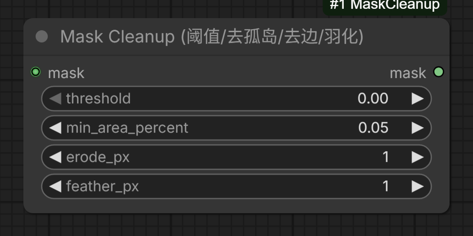
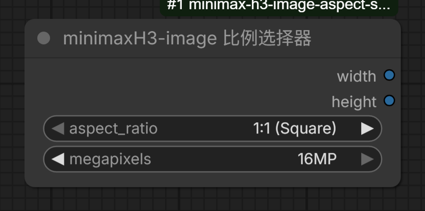
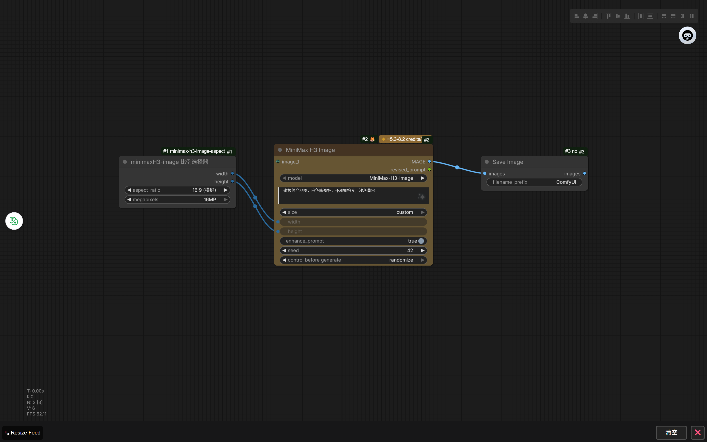

# ComfyUI Node Toolkit（节点工具包）

两个轻量 ComfyUI 自定义节点，零额外依赖：

1. **Mask Cleanup（阈值 / 去孤岛 / 去边 / 羽化）** —— 抠图 mask 后处理，专治「背景灰雾、细小碎块、边缘光晕」。
2. **minimaxH3-image 比例选择器** —— 把 MiniMax H3-Image 官方分辨率表做成下拉节点，直接输出 width / height。

> 配套的 5 个抠图工作流见姊妹项目：[ComfyUI 抠图工作流（个人使用）](https://github.com/LZM2023/comfyui-matting-workflows)

---

## 安装

```bash
cd ComfyUI/custom_nodes
git clone https://github.com/LZM2023/comfyui-node-toolkit.git
```

重启 ComfyUI。无需 `pip install`（只用 torch / numpy / opencv，ComfyUI 已自带）。

---

## 节点 1：Mask Cleanup（阈值/去孤岛/去边/羽化）

分类：`image/mask`



界面上的元素逐个说明：

| 界面元素 | 作用 |
|---|---|
| 左侧绿色圆点 `mask` | **输入**：待清理的 MASK（白=主体），来自 BiRefNet / InSPyReNet / SDMatte / Lucida 等抠图节点 |
| `threshold` 滑块（默认 0.00） | **硬阈值**。`0` = 保留软 alpha（人像/发丝）；`0.06~0.12` = 把低于该值的半透明像素直接压成 0，去背景灰雾（商品图推荐 0.08） |
| `min_area_percent`（默认 0.05） | **去孤岛**。丢弃面积小于整图该百分比的孤立小块（0 = 关闭），用来清掉背景里的零星碎点 |
| `erode_px`（默认 1） | **收缩**。把主体轮廓向内收 N 像素（0 = 关闭），去掉边缘 1~2px 的浅色光晕 |
| `feather_px`（默认 1） | **羽化**。对最终 mask 做高斯羽化（0 = 关闭），让边缘更自然 |
| 右侧绿色圆点 `mask` | **输出**：清理后的 MASK，接 `Invert Mask` → `Join Image with Alpha` 合成透明图 |

典型接法：

```
抠图模型 MASK ──► Mask Cleanup ──► Invert Mask ──► Join Image with Alpha ──► Save Image
```

> 注意：ComfyUI 的 `Join Image with Alpha` 把 MASK 当透明度用，所以合成前要先 `Invert Mask`。

---

## 节点 2：minimaxH3-image 比例选择器

分类：`MiniMax H3 Image`



界面上的元素逐个说明：

| 界面元素 | 作用 |
|---|---|
| `aspect_ratio` 下拉 | 宽高比：`1:1`、`4:3`、`3:4`、`3:2`、`2:3`、`16:9`、`9:16`、`21:9`（横屏/竖屏分列，1:1 不分） |
| `megapixels` 下拉 | 像素档位：`4MP` / `16MP`（默认 16MP，4MP = 各边减半） |
| 右侧 `width` 蓝色圆点 | **输出**：宽度 INT |
| 右侧 `height` 蓝色圆点 | **输出**：高度 INT |

| 宽高比 | 16MP | 4MP |
|---|---|---|
| 1:1 | 4096×4096 | 2048×2048 |
| 4:3 横屏 | 4736×3552 | 2368×1776 |
| 3:4 竖屏 | 3552×4736 | 1776×2368 |
| 3:2 横屏 | 5024×3360 | 2512×1680 |
| 2:3 竖屏 | 3360×5024 | 1680×2512 |
| 16:9 横屏 | 5472×3072 | 2736×1536 |
| 9:16 竖屏 | 3072×5472 | 1536×2736 |
| 21:9 横屏 | 6272×2688 | 3136×1344 |

所有尺寸都已对齐到 16 的倍数。

### 配套工作流：MiniMax H3 按比例出图

工作流文件：[`workflows/minimax-h3-aspect-selector.json`](workflows/minimax-h3-aspect-selector.json)



接线方式（截图里的三条线）：

1. **比例选择器** `width` → **MiniMax H3 Image** 节点的 `width`（先把节点的 `size` 下拉切到 **custom**，节点才会展开 `width` / `height` 两个输入）
2. **比例选择器** `height` → **MiniMax H3 Image** 节点的 `height`
3. **MiniMax H3 Image** 的 `IMAGE` → **Save Image** 的 `images`

> 如果你用的是 `MiniMax H3 Image Conditioning` 节点：它同样有 `width` / `height` 两个 INT 输入，接线方式完全一样（另外还需按你的模型接 `clip` / `vae`）。

---

## 兼容性

- ComfyUI 0.45+（Mask Cleanup 使用标准 MASK 类型）
- 不引入 transformers / diffusers 依赖，不会触发版本升级
- MIT License
